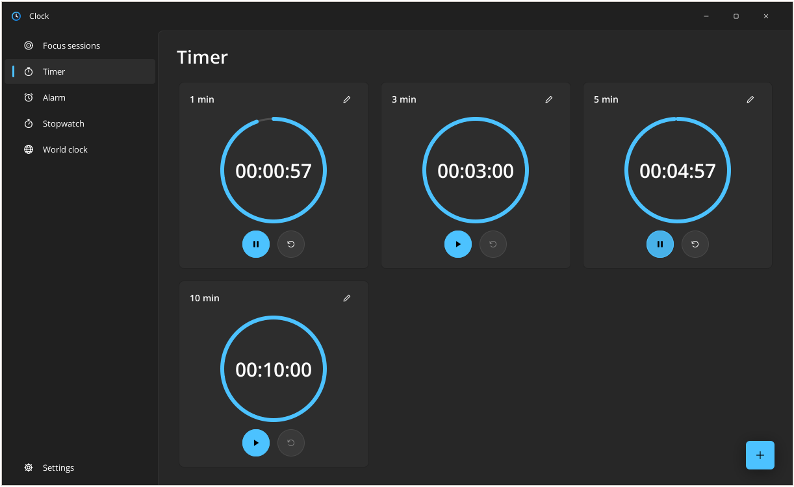
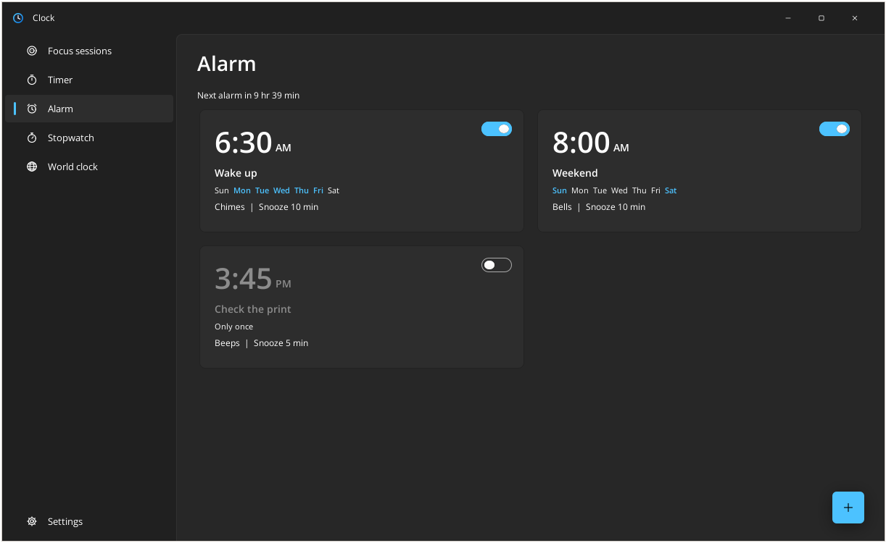
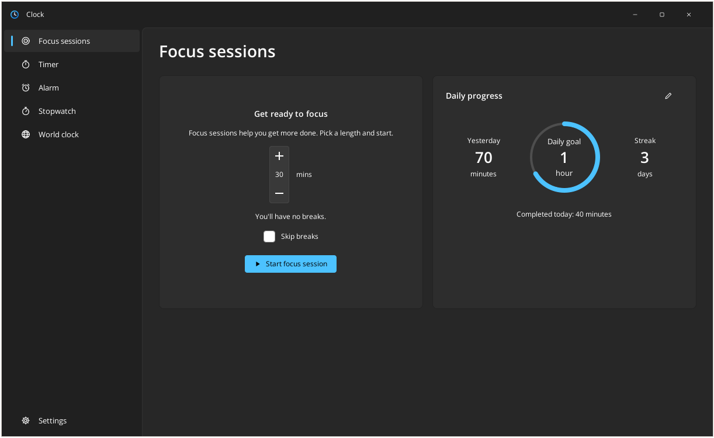
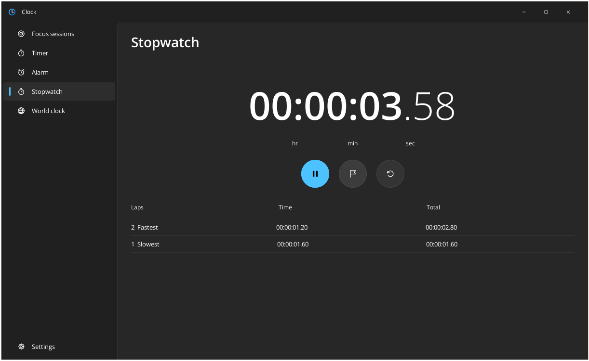
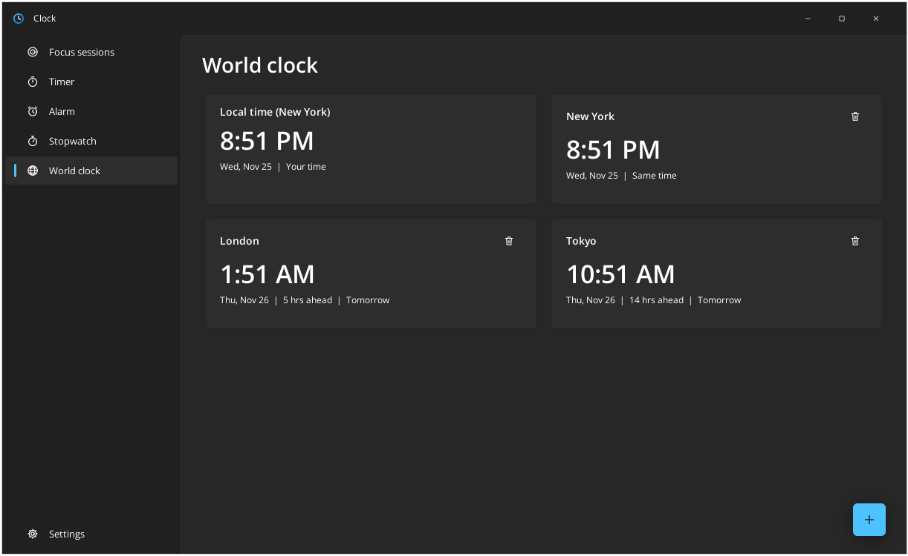

# pi-clock

A Windows 11 style Clock app for the Raspberry Pi (built for the Pi 5, works on other Pis running Raspberry Pi OS). Native GTK app with the Windows 11 dark look, made to match [pi-explorer](https://github.com/wvfouram/pi-explorer) and [pi-taskmgr](https://github.com/wvfouram/pi-taskmgr).



## Features

- **Timers** with progress rings; run several at once, name them, add your own
- **Alarms** with repeat days, snooze (5 to 30 minutes) and four sounds
- **Stopwatch** with laps, marking the fastest and slowest lap
- **World clock** for about 85 cities (or any time zone), showing how far ahead or behind they are
- **Focus sessions** with automatic breaks, a daily goal and a streak
- Keeps running in the background after you close it, so alarms and timers still go off (starts at login)
- Makes its own alarm sounds, so no extra sound packages are needed






## Install

In a terminal on the Pi (as your normal user, not with sudo):

```
git clone https://github.com/wvfouram/pi-clock.git && bash pi-clock/install.sh
```

Then open **Clock** from the menu, or run `pi-clock`.

To update later:

```
cd ~/pi-clock && git pull && bash install.sh
```

## Uninstall

```
bash pi-clock/uninstall.sh
```

## License

MIT
